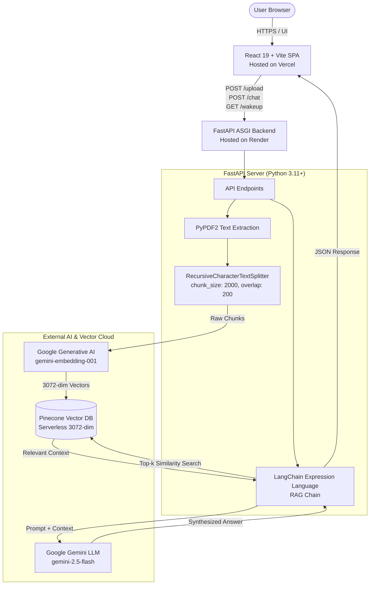
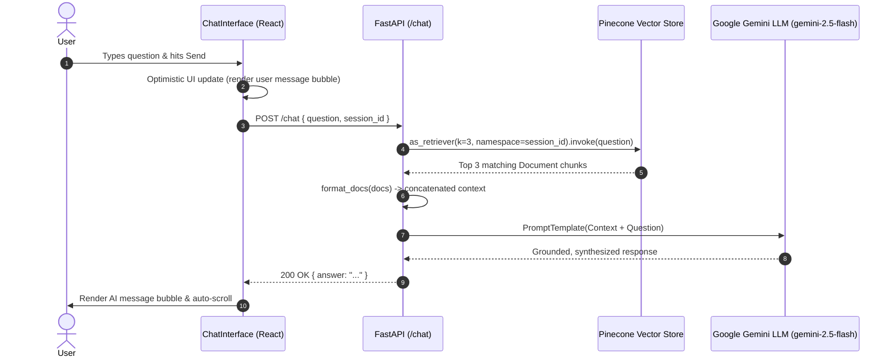

# System Architecture & Technical Design

This document details the architectural design, component interactions, data ingestion pipelines, and retrieval mechanisms of the **AI-Powered RAG Document Analyzer**.

---

## 1. High-Level Architecture

The system is designed as a decoupled, microservice-style full-stack application leveraging modern cloud platforms and managed AI APIs:



---

## 2. Ingestion & Vectorization Flow

When a user selects and submits a PDF, the document travels through the ingestion pipeline:

```mermaid
sequenceDiagram
    autonumber
    actor User
    participant UI as React Frontend
    participant API as FastAPI (/upload)
    participant FS as Temp Storage (temp_uploads/)
    participant Ext as PyPDF2 Reader
    participant Split as Text Splitter
    participant Embed as Gemini Embeddings API
    participant Pine as Pinecone Vector Store

    User->>UI: Select PDF & click "Process Document"
    UI->>UI: Client validation (Size <= 5MB, MIME type)
    UI->>UI: Generate session_id (e.g., session-173000-xyz)
    UI->>API: POST /upload (file: Binary, session_id: String)
    API->>FS: Save binary stream to temp_uploads/
    API->>Ext: extract_text_from_pdf(filepath)
    Ext-->>API: Extracted raw text string
    API->>Split: RecursiveCharacterTextSplitter(chunk_size=2000, overlap=200)
    Split-->>API: List of Document chunks
    API->>Embed: Embed document chunk text batches
    Embed-->>API: Vector arrays (3072 dimensions)
    API->>Pine: PineconeVectorStore.from_documents(namespace=session_id)
    Pine-->>API: Indexing confirmed
    API->>FS: Clean up temp file (os.remove)
    API-->>UI: 200 OK { message, filename, total_chunks }
    UI->>User: Display success toast & activate chat interface
```



### Ingestion Details & Parameter Choices
* **Chunk Size (`2000` chars):** Balances conversational semantic granularity with context preservation for Gemini's large attention window.
* **Chunk Overlap (`200` chars):** Prevents information fragmentation across boundaries, ensuring sentence continuity.
* **Embedding Model:** `models/gemini-embedding-001` generates 3072-dimensional dense vector embeddings.
* **Storage Target:** Pinecone index (`PINECONE_INDEX_NAME`), partitioned by `namespace=session_id` (3072-dim, Cosine metric).

---

## 3. Query & Retrieval (RAG) Flow

Once processed, queries are executed via a LangChain Expression Language (LCEL) chain:



### Prompt Engineering Template
```text
Use the following pieces of retrieved context to answer the question. 
If you don't know the answer, just say that you don't know. 
Keep the answer concise and professional.

Context: {context}

Question: {question}

Answer:
```

---

## 4. Multi-Tenant Data Isolation Strategy

Data isolation is a core security requirement for public document analyzer platforms.

| Layer | Implementation | Isolation Guarantee |
| :--- | :--- | :--- |
| **Client Session** | Generated randomly upon document selection (`session-${Date.now()}-${random}`) | Unique to the browser tab/session instance |
| **Vector Storage** | Pinecone `namespace=session_id` | Queries executed against namespace $N$ are physically isolated from namespace $M$; cross-contamination is impossible. |
| **Ephemeral File** | Uploaded to `temp_uploads/{filename}` | Automatically deleted in a `finally` block immediately after vectorization. |

---

## 5. Cold-Start Management (Render Free Tier)

Render's free compute tier enters a dormant state after 15 minutes of inbound inactivity. Spin-up latency typically ranges between 30 and 60 seconds.

### Client-Side Wake-up Protocol:
1. `ServerStatusBanner.jsx` triggers a lightweight fetch to `GET /wakeup` on component mount.
2. A 3-second delay timer is scheduled concurrently.
3. If the backend responds within 3 seconds, the banner never displays.
4. If the request exceeds 3 seconds, the sticky warning banner renders:  
   `"⏳ Wait for a minute as the Render backend is starting..."`
5. Upon response receipt (or error), the banner is automatically dismissed.

---

## 6. Architectural Tradeoffs & Constraints

1. **In-Memory Session State vs Persistence:**
   * *Current:* Sessions exist only in browser memory and Pinecone namespaces. Refreshing the browser creates a new session.
   * *Tradeoff:* Eliminates user management overhead and database complexity, but loses previous chat history on browser reload.
2. **Single-Turn vs Multi-Turn Conversation:**
   * *Current:* Single-turn context QA (query + retrieved chunks).
   * *Tradeoff:* Reduced token consumption and latency, but cannot answer conversational follow-up questions (e.g., "What did you mean by that second point?").
3. **Synchronous REST vs Streaming Responses:**
   * *Current:* Full JSON payload response over HTTP POST.
   * *Tradeoff:* Simpler error handling and component state, but higher Time-To-First-Token (TTFT) for long responses.
