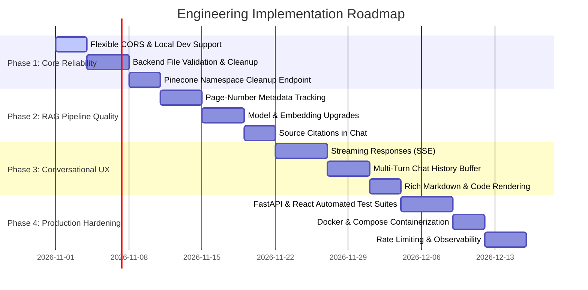

# Project Improvement Roadmap & Backlog

This document serves as the tactical engineering backlog for the **AI-Powered RAG Document Analyzer**. It classifies known architectural limitations, technical debt, and prioritized milestones to guide future development and agent-driven enhancements.

---

## 1. Codebase Audit & Gap Analysis

An inspection of the current implementation reveals the following priority areas for improvement:

| Category | Current State | Risk / Limitation | Recommended Action |
| :--- | :--- | :--- | :--- |
| **CORS Configuration** | Hardcoded to Vercel production URL | Blocks local development (`localhost:5173` fails with CORS error) | Implement environment-driven origin resolution (`CORS_ORIGINS`). |
| **File Cleanup** | Files stay in `temp_uploads/` permanently | Unbounded disk growth on the server; potential storage exhaustion | Use ephemeral temp files or enforce post-processing deletion in a `finally` block. |
| **Backend File Validation** | Only checks `file.filename.endswith(".pdf")` | Vulnerable to malicious extensions; no server-side payload size cap | Validate magic bytes (`%PDF-`) and enforce server-side size limit (e.g. 5MB). |
| **Vector Lifecycle** | Namespaces created indefinitely | Accumulates orphaned vectors in Pinecone over time | Add session teardown endpoint (`DELETE /session/{session_id}`). |
| **RAG Retrieval Quality** | `k=3`, no metadata, no score threshold | Context lacks page numbers, citations, or relevance filtering | Attach page number metadata to chunks; include citation annotations in responses. |
| **Response Latency (TTFT)** | Full synchronous REST payload | User waits 3–8s with a generic spinner; high perceived latency | Implement Server-Sent Events (SSE) streaming (`POST /chat/stream`). |
| **Conversation Memory** | Single-turn QA only | Follow-up questions fail to resolve pronouns or prior context | Integrate multi-turn sliding window conversation history. |
| **Frontend UI/UX** | Plain text rendering in chat bubbles | Markdown formatting (bold, bullet points, tables, code) is rendered raw | Add `react-markdown` and syntax highlighting to `ChatInterface.jsx`. |
| **Automated Testing** | Zero automated tests | High risk of regressions during model or package upgrades | Implement `pytest` test suite for backend and `vitest` for frontend. |

---

## 2. Prioritized Roadmap Phases



---

## 3. Phase Breakdown & Implementation Specs

### Phase 1: Core Reliability & Developer Experience
* **1.1 Configurable CORS Middleware:**
  * Update `backend/main.py` to read allowed origins from an environment variable:
    ```python
    cors_origins = os.getenv("CORS_ORIGINS", "https://ai-rag-analyzer.vercel.app,http://localhost:5173,http://127.0.0.1:5173").split(",")
    app.add_middleware(CORSMiddleware, allow_origins=[origin.strip() for origin in cors_origins], ...)
    ```
* **1.2 Safe File Lifecycle & Ingestion Validation:**
  * Replace static folder accumulation with Python's `tempfile.NamedTemporaryFile` or wrap upload logic:
    ```python
    try:
        # process PDF
    finally:
        if os.path.exists(filepath):
            os.remove(filepath)
    ```
  * Verify MIME header (`application/pdf`) and read the first 4 bytes to check for `%PDF`.
  * Enforce server-side 5MB limit before writing chunks to disk.
* **1.3 Session Cleanup Endpoint:**
  * Implement `DELETE /session/{session_id}` calling `vectorstore.delete(delete_all=True, namespace=session_id)`.
  * Trigger this from the frontend when the user clicks "Upload New Document".

---

### Phase 2: RAG Pipeline & Retrieval Upgrades
* **2.1 Document Chunking with Page & Source Metadata:**
  * Upgrade `extract_text_from_pdf` to yield structured objects per page:
    ```python
    for page_num, page in enumerate(reader.pages, start=1):
        text = page.extract_text()
        # attach metadata: {"page": page_num, "source": file.filename}
    ```
* **2.2 Upgraded Model Foundations:**
  * Transition from `models/gemini-embedding-001` to `text-embedding-004` or modern Google embeddings for higher semantic capture.
  * Update LLM orchestration to use stable production models (`gemini-2.5-flash` or `gemini-1.5-flash`).
* **2.3 Grounded Citations & Confidence:**
  * Modify the RAG prompt to cite source page numbers:
    `"Cite the relevant page numbers from the provided context in brackets, e.g. [Page 3]."`
  * Return `{ "answer": "...", "sources": [{"page": 3, "excerpt": "..."}] }` in the API response.

---

### Phase 3: Conversational Memory & Streaming UX
* **3.1 Server-Sent Events (SSE) Streaming:**
  * Implement `StreamingResponse` on a new `POST /chat/stream` endpoint.
  * Stream chunks directly from `llm.astream()` as token deltas arrive.
  * Update `ChatInterface.jsx` to consume the response via `ReadableStream` reader, providing a typewriter effect.
* **3.2 Multi-Turn Conversational Memory:**
  * Pass past message pairs (`history: [{"role": "user"|"ai", "content": "..."}]`) in `ChatRequest`.
  * Incorporate conversational context into the RAG prompt or rewrite the query using a condensing prompt before retrieval.
* **3.3 Enhanced UI Rendering:**
  * Install `react-markdown` and `rehype-highlight` in frontend.
  * Render tables, bullet points, headers, and code blocks cleanly in AI response bubbles.
  * Add a "Copy to Clipboard" button on AI answers.

---

### Phase 4: Production Hardening, Testing & DevOps
* **4.1 Test Automation:**
  * Backend: `pytest`, `pytest-asyncio`, and `httpx` testing `/upload`, `/chat`, `/wakeup`, and error handlers.
  * Frontend: `vitest` and `@testing-library/react` testing upload validation, message rendering, and server status banner.
* **4.2 Containerization:**
  * Create `backend/Dockerfile` using `python:3.11-slim` with a non-root user.
  * Create `docker-compose.yml` to spin up local backend + frontend with a single command.
* **4.3 Rate Limiting & Monitoring:**
  * Add `slowapi` rate limiting to protect Google Gemini API quotas (e.g., 20 requests per minute per IP).
  * Add health check endpoint `GET /health` reporting memory usage and dependency connectivity.

