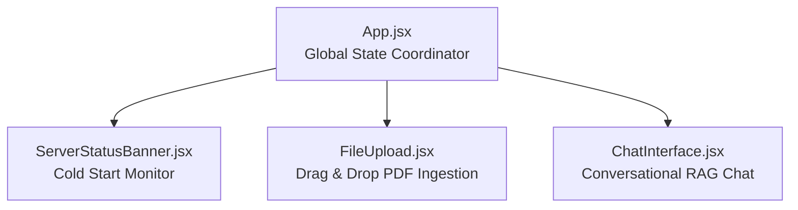

# Frontend — AI Document Analyzer UI

The frontend client for the **AI Document Analyzer** is a React 19 Single Page Application (SPA) built with Vite. It provides an interface for uploading PDFs, managing server cold starts, and conversing with an AI powered by RAG.

---

## 1. Component Architecture & State Hierarchy

The component tree is structured as follows:

### Component Breakdown
* **`App.jsx`:** Holds top-level coordination state:
  * `isFileProcessed (boolean)`: Controls whether chat input is unlocked and whether upload button switches to "Upload New Document".
  * `sessionId (string)`: Unique session key used to isolate Pinecone vector queries for the current document.
* **`ServerStatusBanner.jsx`:** Mounts on page load and pings `GET /wakeup` on the Render backend. If the backend does not respond within 3 seconds, a warning banner alerts the user to wait during container spin-up.
* **`FileUpload.jsx`:**
  * Handles drag-and-drop or file picker selection.
  * Enforces client-side validation (max 5MB file size limit, `application/pdf` MIME check).
  * Sends `multipart/form-data` to `POST /upload`.
  * Emits `onProcessSuccess(sessionId)` when vectorization completes.
* **`ChatInterface.jsx`:**
  * Maintains the local message list (`[{ role: 'user' | 'ai', text }]`).
  * Features optimistic UI message rendering.
  * Auto-scrolls to the newest message via an anchored React `useRef`.
  * Dispatches queries to `POST /chat` with the current `session_id`.

---

## 2. Environment Variables

The frontend relies on Vite environment variables prefixed with `VITE_`:

| Variable | Description | Example |
| :--- | :--- | :--- |
| `VITE_API_BASE_URL` | Base URL of the FastAPI backend service | `https://ai-rag-analyzer-backend.onrender.com` (Prod) `http://127.0.0.1:8000` (Dev) |

> **Note:** For local development, create a `.env.local` file in this directory to override `VITE_API_BASE_URL` without altering production configuration.

---

## 3. Development Scripts

Run the following commands from the `frontend/` directory:

| Command | Action |
| :--- | :--- |
| `npm install` | Installs all package dependencies from `package.json` |
| `npm run dev` | Launches the local Vite development server with HMR at `http://localhost:5173` |
| `npm run build` | Compiles the production-ready bundle into the `dist/` directory |
| `npm run preview` | Locally serves the compiled production build from `dist/` |
| `npm run lint` | Runs ESLint to check for code quality and React hook rules |

---

## 4. Styling Architecture

* **`App.css`:** Contains layout rules, responsive breakpoints (`@media (max-width: 768px)`), drop-zone styles, and base typography.
* **Component-Level Styles:** Key dynamic layout styles (such as chat bubble colors, scroll windows, and toast overlays) are styled using semantic inline styles to maintain encapsulation without requiring heavy external CSS libraries.

---

## 5. Planned Enhancements (Roadmap)

Refer to [ROADMAP.md](../ROADMAP.md) for details on planned frontend improvements:
* **Markdown Rendering:** Integration of `react-markdown` to format lists, bold text, and code snippets returned by Gemini.
* **Streaming Responses:** Replacing synchronous fetch with `ReadableStream` reader for real-time token streaming.
* **Session Reset without Reload:** Resetting state internally rather than triggering `window.location.reload()`.
